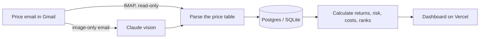

# Fund Board: Pakistan mutual fund NAV tracker and performance dashboard

[](https://www.python.org/)
[](https://fastapi.tiangolo.com/)
[](https://vercel.com/)
[](https://vercel.com/marketplace/neon)

**Fund Board is an open-source dashboard that tracks the daily prices of Al Meezan mutual funds in Pakistan.** It reads the
"Fund Prices and Performance" emails that Al Meezan Investments sends to investors, stores every NAV in a database,
and calculates returns, risk, costs and category rankings. It shows everything on a web page you can host for free
on Vercel.

It is built for two kinds of people: investors who already hold Meezan funds and want to follow them, and people
choosing a fund who want to compare like with like.

*Last updated: 29 September 2026*

---

## Contents

- [What it does](#what-it-does)
- [How it works](#how-it-works)
- [The metrics, explained](#the-metrics-explained)
- [Annualized vs absolute returns](#annualized-vs-absolute-returns-the-mufap-convention)
- [Deploy on Vercel](#deploy-on-vercel)
- [Run it locally](#run-it-locally)
- [Security and privacy](#security-and-privacy)
- [FAQ](#faq)
- [Limitations](#limitations)
- [Disclaimer](#disclaimer)

---

## What it does

| Page | What you see | What it's for |
|---|---|---|
| **Today** | How many market-linked funds rose or fell since the last price, the best cash fund yield, each category's leader, and plain-language notes for investors | A 30-second daily brief |
| **Funds** | Every fund in one table: NAV, last move, MTD, FYTD, CYTD, fiscal-year returns, entry and exit loads, price risk and rank. Filter by return basis or category, search, and sort | Finding and screening funds |
| **Fund page** | A "Growth of 100" chart with a date slider, the fund's returns, risk measures, costs, track record and its ranking among true peers | Checking one fund in depth |
| **Compare** | Up to 8 funds on one chart and one table, with a warning when their returns are quoted on different bases | Choosing between funds |

Other things it does:

- **Updates by itself.** It checks for new prices when the page is opened, from an **Update prices** button, and on a daily schedule.
- **Remembers your funds.** Star the funds you hold and they appear on the Today page. The list is kept in your own browser.
- **Merges renamed funds.** When the fund company renames a fund between email templates ("Paidaar Munafa Plan-34" became "Paidar Munafa Plan 34"), the two price histories are joined into one.
- **Reads image-only emails.** Emails that arrive as a picture are read with Claude vision, if you add an Anthropic API key.

**Tested on real data:** 129 price emails from 16 March to 29 September 2026, giving 5,807 daily prices for
50 live funds in 11 categories. After merging renamed funds, 93 fund names became 59 price histories.

Categories covered include money market, fixed income, fixed-term plans (Open End CIS under SECP Circular No. 3 of
2022), fund of funds, equity, balanced, asset allocation, commodity (gold), exchange traded fund, voluntary pension
scheme and capital protected funds.

---

## How it works



1. **Collect.** The server signs in to your Gmail over IMAP with an app password and reads, without marking anything as read, the emails from `newsletters@almeezangroup.com` with "Fund Prices" in the subject.
2. **Parse.** It reads the HTML price table: fund, category, launch date, repurchase and offer prices, NAV, MTD, FYTD, CYTD, the last two fiscal years and since-inception returns. Both the current and the older email layouts are supported.
3. **Store.** Each fund's price for each day is saved once. Re-reading an email never creates duplicates.
4. **Analyze.** It rebuilds a total-return index for every fund and calculates the metrics below.
5. **Show.** The dashboard is one fast page with all prices built in, plus interactive Plotly charts.

---

## The metrics, explained

| Metric | Meaning |
|---|---|
| **NAV** | Net asset value per unit: the price of one unit of the fund |
| **MTD** | Return so far this month |
| **FYTD** | Return since 1 July, the start of Pakistan's fiscal year (July to June) |
| **CYTD** | Return since 1 January |
| **FY2026, FY2025** | Return over a whole fiscal year |
| **Since launch, per year** | The since-inception return turned into a yearly rate, so old and new funds compare fairly (funds at least one year old) |
| **Last move** | Total return since the previous price |
| **1 year** | Return over the last 12 months of collected prices |
| **Volatility** | How much the price swings in a typical year. Higher means a bumpier ride |
| **Max drawdown** | The worst fall from a high point, in the history collected so far |
| **Below peak** | How far the fund sits under its highest point today |
| **Entry load** | Extra you pay on top of NAV when you buy (offer price vs NAV) |
| **Exit load** | Amount deducted from NAV when you sell (repurchase price vs NAV) |
| **Rank** | Position by FYTD return among funds in the same category that quote returns the same way |

### Why the charts don't use NAV directly

A fund's NAV drops when it pays a dividend, even though investors lost nothing. For example, if a fund at NAV 100
pays 10 per unit, its NAV falls to 91, while its reported FYTD return rises from 5.00% to 6.05%. The real result
that day is +1.0%, not −9%.

So Fund Board rebuilds a **total-return index** from each fund's reported FYTD return. "Growth of 100", last move,
1-year return, volatility and drawdown all use this index, so dividend payouts never look like losses.

---

## Annualized vs absolute returns (the MUFAP convention)

**In Pakistan, money market and income funds quote their returns as a yearly rate, while equity and other
market-linked funds quote the actual change.** This follows the [MUFAP](https://www.mufap.com.pk/) reporting
convention, and it means the two kinds of percentages can't be compared directly.

| Fund type | A 10% FYTD return means | Example categories |
|---|---|---|
| Money market and income funds | The fund is earning at a rate of 10% **per year** | Money market, fixed income, fixed-term plans, cash-like pension sub-funds |
| Market-linked funds | Your money actually grew **10%** since 1 July | Equity, balanced, asset allocation, gold, ETF |

For example, a money market fund showing 9.99% FYTD on 29 September has been open for about 90 days of the fiscal
year, so its actual growth is roughly 2.5%.

Fund Board labels every fund as **Per year** or **Absolute**. It ranks funds only against peers on the same basis.
It also warns you on the Compare page when you mix the two. A fund counts as annualized when its category or name
says so (`ANNUALIZED` in [core.py](core.py)), or when its NAV creeps up steadily like a cash fund's.

---

## Deploy on Vercel

[](https://vercel.com/new/clone?repository-url=https%3A%2F%2Fgithub.com%2Fhamad-tariq%2FNafa&env=MI_EMAIL,MI_APP_PASSWORD,CRON_SECRET&envDescription=Your%20Gmail%20address%2C%20a%20Gmail%20app%20password%20and%20a%20long%20random%20secret&project-name=fund-board)

1. **Import the repo** into Vercel. It's detected as a FastAPI app (`app.py`).
2. **Add a database.** Go to **Storage → Create Database → Neon (Serverless Postgres)** and connect it to the project for Production and Preview. This sets `DATABASE_URL`. Pick the Neon region closest to your Vercel functions; Vercel's default is Washington, D.C., so choose US East.
3. **Add the environment variables** below.
4. **Redeploy** so the new variables take effect, then open the site. The first visit imports every price email already in your inbox (about 3 minutes for 130 emails) and shows the progress in the header.

### Environment variables

| Variable | Required | What it is |
|---|---|---|
| `MI_EMAIL` | Yes | The Gmail address that receives the price emails |
| `MI_APP_PASSWORD` | Yes | A [Gmail app password](https://support.google.com/accounts/answer/185833). Turn on 2-Step Verification, then create one at [myaccount.google.com/apppasswords](https://myaccount.google.com/apppasswords) |
| `CRON_SECRET` | Yes | Any long random string. It signs the page's API tokens and authorizes the daily job and uploads |
| `DATABASE_URL` | Yes, on Vercel | Postgres connection string, set by the Neon integration (`POSTGRES_URL` also works) |
| `ANTHROPIC_API_KEY` | No | Reads image-only emails and screenshots with Claude vision |
| `MI_IMAP_FOLDER` | No | The mailbox folder to read if a filter archives the emails, for example `[Gmail]/All Mail`. Default `INBOX` |
| `MI_SENDER` | No | Sender address to look for. Default `newsletters@almeezangroup.com` |
| `MI_IMAP_HOST` | No | IMAP server for a non-Gmail mailbox. Default `imap.gmail.com` |

### Keeping prices current

- **When someone visits.** The dashboard checks for new prices by itself when the last check is more than 30 minutes old, and refreshes while it's open.
- **On demand.** **Update prices** in the header checks right away. Checks are limited to one every 10 minutes.
- **Every day.** [`vercel.json`](vercel.json) runs a [Vercel Cron Job](https://vercel.com/docs/cron-jobs) at 19:00 UTC (midnight in Pakistan), so prices stay current even when nobody visits. The Hobby plan allows one run a day; on Pro you can change the schedule to `0 */2 * * *` for a check every 2 hours.

If an update fails, the page only says it didn't finish. The details are in the server logs (Vercel → Logs).

---

## Run it locally

```bash
pip install -r requirements.txt  # then create a .env file with the variables above
uvicorn app:app --reload        # http://127.0.0.1:8000
python test_core.py             # parser, metrics and API self-check
```

Locally, prices are saved to `data/funds.db` (SQLite). Set `DATABASE_URL` in `.env` to use Postgres instead.

### Add a screenshot or a saved email

You can add prices without Gmail by sending a file to the ingest endpoint with your `CRON_SECRET`:

```bash
curl -X POST -H "Authorization: Bearer $CRON_SECRET" -H "Content-Type: image/png" --data-binary @prices.png https://<your-site>/api/ingest
curl -X POST -H "Authorization: Bearer $CRON_SECRET" -H "Content-Type: message/rfc822" --data-binary @email.eml https://<your-site>/api/ingest
```

HTML files (`text/html`) and JPEG screenshots (`image/jpeg`) work too. Screenshots need `ANTHROPIC_API_KEY`.

---

## Security and privacy

- **No public API or docs.** Swagger UI, ReDoc and the OpenAPI schema are switched off. Prices and history are built into the page itself, so there are no data URLs to scrape.
- **Page-only endpoints.** `GET /api/status` and `POST /api/refresh` answer only this site's own page. The request must come from the same site and carry a signed token that is valid for 6 hours. Everything else gets a 404.
- **Owner-only actions.** The daily job and uploads need `Authorization: Bearer <CRON_SECRET>`.
- **Read-only mailbox access.** The app opens your mailbox read-only and never marks, moves or deletes emails. You can revoke the app password at any time.
- **Nothing identifying on the site.** The public dashboard never says where the prices come from, and update errors are shown only in general terms.

| Path | Who can use it |
|---|---|
| `/` and `/assets/*` | Everyone |
| `GET /api/status`, `POST /api/refresh` | Only the dashboard page (same-site request plus signed token) |
| `GET /api/refresh` | Vercel Cron, with the `CRON_SECRET` |
| `POST /api/ingest` | The owner, with the `CRON_SECRET` |

---

## Project structure

| File | Purpose |
|---|---|
| [`app.py`](app.py) | FastAPI app: serves the page, the page-only API, the daily job and uploads |
| [`core.py`](core.py) | Mailbox reader, email and image parsing, storage, return and risk calculations, insights |
| [`page.html`](page.html) | The page template the server fills with prices and a token |
| [`web/app.js`](web/app.js) | The dashboard: Today, Funds, Fund and Compare views, charts, update controls |
| [`web/app.css`](web/app.css) | Styles, with light and dark themes |
| [`test_core.py`](test_core.py) | Self-check for parsing, metrics, security and public wording |
| [`vercel.json`](vercel.json) | Function timeout and the daily cron job |

**Tech stack:** Python 3.12, FastAPI, SQLAlchemy, pandas, Neon Postgres (SQLite locally), Plotly.js, plain JavaScript
with no build step, and the Anthropic API for optional image reading.

---

## FAQ

### How can I track Al Meezan mutual fund prices automatically?
Deploy Fund Board with the Gmail address that receives the Al Meezan "Fund Prices and Performance" emails. It reads
each new email, saves every fund's NAV and returns, and updates the dashboard by itself, every day.

### Why are money market fund returns shown "per year"?
Pakistani money market and income funds report annualized returns, following the MUFAP convention. A 10% FYTD figure
is a yearly rate, not what the fund has earned since July. Fund Board labels these funds **Per year** and never ranks
them against funds that report absolute returns.

### Why doesn't the growth chart use NAV?
NAV falls when a fund pays a dividend, which would look like a loss. The chart uses a total-return index rebuilt from
each fund's reported FYTD return, so it shows what an investor actually earned, dividends included.

### Is my Gmail account safe?
The app uses a Gmail app password, not your main password. It is stored only as an environment variable on your
server. The mailbox is opened read-only, and you can revoke the app password from your Google account at any time.

### Can I use it without Gmail?
Yes. Upload a screenshot, a saved `.eml` email or the email's HTML to `/api/ingest` with your `CRON_SECRET`. Screenshots
need an Anthropic API key.

### How often are prices updated?
When someone opens the dashboard and the last check is more than 30 minutes old, when you press **Update prices**,
and once a day on a schedule. The price emails usually arrive every day or two, sometimes two or three times a day.

### Does it work with other fund companies?
The parser is built for the Al Meezan email layout. `MI_SENDER` and `MI_IMAP_HOST` let you point it at another sender
or mailbox, but a different table layout may need changes in `core.py`. Screenshots read with Claude vision don't
depend on the layout.

### What does it cost to run?
For personal use it fits within the free Vercel Hobby plan and Neon's free Postgres plan. The Anthropic API key is
optional and billed per use, only when image-only emails or screenshots are read.

### Is this investment advice?
No. Fund Board is for information only. Past returns don't guarantee future returns.

---

## Limitations

- **History starts with your inbox.** It covers only the emails you still have. Metrics such as 1-year return and volatility improve as more prices build up.
- **One email format.** The parser follows Al Meezan's email layout and needs an update if that layout changes. Image-only emails need an Anthropic API key.
- **Browser-visible data.** Anything the page shows can be copied. The API lock keeps other sites and casual scripts out, not a determined scraper.
- **Daily cron on Hobby.** Vercel Hobby runs the scheduled check once a day. Visits and the **Update prices** button fill the gaps.

---

## Disclaimer

Fund Board is an independent, personal project. It is not affiliated with, endorsed by or connected to Al Meezan
Investment Management Limited, Meezan Bank or MUFAP. Fund names and figures belong to their publishers and are shown
as reported in their price emails. Nothing here is investment advice; always read a fund's offering document before
investing.
